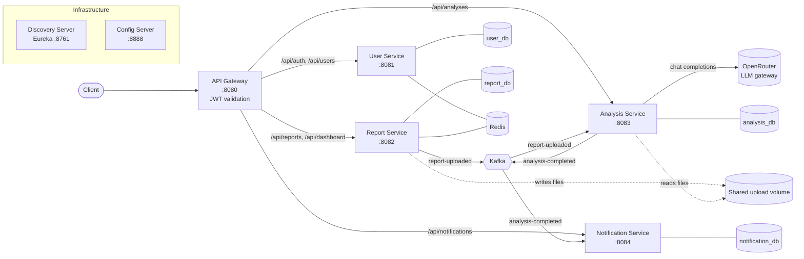

# AI-Powered Performance Analysis Platform

A microservices backend that accepts load-test reports from performance tools, stores them, and produces an AI-generated analysis: a list of severity-ranked findings with concrete recommendations. Users are notified when an analysis completes.

Supported input tools: **Apache JMeter** and **Gatling**.


---

## Table of Contents

- [Features](#features)
- [Architecture](#architecture)
- [Services](#services)
- [Event Flow](#event-flow)
- [AI Analysis Implementation](#ai-analysis-implementation)
- [API Reference](#api-reference)
- [Data Model](#data-model)
- [Security](#security)
- [Configuration](#configuration)
- [Running the Platform](#running-the-platform)
- [Ports](#ports)
- [Project Structure](#project-structure)
- [Technology Stack](#technology-stack)
- [Testing](#testing)
- [Pending Work and Known Issues](#pending-work-and-known-issues)
- [Further Documentation](#further-documentation)

---

## Features

- **User accounts** with registration, login, JWT access and refresh tokens, logout (refresh-token revocation), and profile management.
- **Report upload** (multipart) for JMeter or Gatling result files, with per-user storage.
- **Automatic AI analysis** on upload, with a manual re-trigger endpoint.
- **Structured findings** with severity (`CRITICAL`, `HIGH`, `MEDIUM`, `LOW`, `INFO`), category, description, recommendation, affected endpoint, observed metric, and recommended threshold.
- **In-app notifications** when an analysis completes or fails, with unread counts and read-state management.
- **Role-based administration**: admins can list all users, reports, and analyses, and deactivate users.
- **Service discovery, centralised configuration, API gateway** with JWT validation and correlation IDs.
- **OpenAPI / Swagger UI** on every service.

---

## Architecture

The platform is a set of Spring Boot services behind a single API gateway. Services register with a Eureka discovery server, read their configuration from a Spring Cloud Config Server, and communicate asynchronously through Apache Kafka. Each business service owns its own PostgreSQL database; Redis is used for caching and token-related state.



### Architectural principles

- **Clean-architecture layering** in every business service:
  - `presentation` — REST controllers and exception advice.
  - `application` — services, DTOs, and MapStruct mappers.
  - `domain` — models, repository interfaces, events, and domain exceptions. No framework dependencies.
  - `infrastructure` — JPA entities and adapters, Kafka publishers and consumers, storage, security filters, and the AI client.
- **Ports and adapters**: domain repositories are interfaces; `*RepositoryAdapter` classes implement them on top of Spring Data JPA.
- **Database per service**: no service reads another service's tables. Cross-service data travels through events or API calls.
- **Gateway-enforced authentication**: the gateway validates the JWT and forwards the caller's identity to downstream services as `X-User-ID` and `X-User-Role` headers.
- **Eventual consistency** between report, analysis, and notification through Kafka.

### Shared library

`shared/common-lib` is a Spring Boot auto-configured library used by every service. It provides:

| Package | Contents |
|---|---|
| `dto` | `ApiResponse<T>` envelope, `ErrorResponse`, `PageResponse<T>` |
| `exception` | `BaseException`, `BusinessException`, `ResourceNotFoundException`, `UnauthorizedException` |
| `security` | `JwtUtil` (issue and validate tokens), `JwtProperties` |
| `web` | `CorrelationIdFilter`, `GlobalExceptionHandlerBase` |
| `util` | `CorrelationIdUtil` (thread-local correlation ID) |
| `audit` | `AuditableEntity` base class (created/updated timestamps) |

---

## Services

| Service | Port | Responsibility | Database | Key integrations |
|---|---|---|---|---|
| `discovery-server` | 8761 | Eureka service registry | — | All services register here |
| `config-server` | 8888 | Central configuration (Basic Auth protected) | — | Serves files from `config-repo/` |
| `api-gateway` | 8080 | Single entry point; routing; JWT validation; correlation IDs | — | Eureka (`lb://` routes) |
| `user-service` | 8081 | Registration, login, tokens, profiles, admin user management | `user_db` | Redis (cache), JWT |
| `report-service` | 8082 | Report upload, file storage, report metadata, analysis requests | `report_db` | Kafka (producer), shared volume, Redis |
| `analysis-service` | 8083 | Consumes uploads, runs AI analysis, stores findings | `analysis_db` | Kafka (both), OpenRouter |
| `notification-service` | 8084 | Creates in-app notifications from analysis results | `notification_db` | Kafka (consumer) |

### user-service

- Validates the JWT itself (`infrastructure/security/JwtAuthenticationFilter`) for its protected routes, in addition to the gateway check.
- **Registration** validates input, rejects duplicate emails (`EmailAlreadyExistsException`), hashes the password, and returns an access token and a refresh token.
- **Login** verifies credentials (`InvalidCredentialsException`) and issues a new token pair.
- **Refresh tokens** are stored in the `refresh_tokens` table. A refresh request checks expiry and the `revoked` flag, then issues new tokens.
- **Logout** marks the presented refresh token as revoked.
- **Deactivation** (admin) soft-disables an account instead of deleting it.
- Role is stored on the user (`Role` enum) and embedded as a `role` claim in the access token.

### report-service

- **Upload** (`POST /api/reports`) validates the tool name (`JMETER` or `GATLING`), writes the file to `${UPLOAD_DIR}/<userId>/<random-uuid>.<ext>`, saves a `Report` row, and publishes a `ReportUploadedEvent`.
- **File storage** (`FileStorageService`) rejects empty files, namespaces files per user, and deletes the file from disk when the report is deleted.
- **Multipart limits**: 50 MB per file, 55 MB per request.
- **Analysis request** (`POST /api/reports/{id}/analyse`) re-publishes the upload event. It is intended to be allowed only when the report is `PROCESSED` (see [Pending Work](#pending-work-and-known-issues)).
- **Metrics**: the schema and repository for per-endpoint metrics (`report_metrics`) exist, but nothing parses the report file to fill them yet.

### analysis-service

- **Consumer**: `ReportUploadedConsumer` listens on `report-uploaded`, restores the correlation ID from the event, and calls `AnalysisServiceImpl.processReportUploadedEvent`.
- **Processing**: creates an `Analysis` in `IN_PROGRESS`, calls the AI service, stores the returned findings, sets the status to `COMPLETED` (or `FAILED` on exception), records the model name, and publishes `analysis-completed`.
- **Read APIs** are scoped to the caller: non-admins only see their own analyses; admins see all.

### notification-service

- Consumes `analysis-completed` and creates a `Notification` for the owning user.
- Successful analyses produce an `ANALYSIS_COMPLETED` notification that includes the finding count. Failed analyses produce `ANALYSIS_FAILED`.
- Notifications are in-app only (read through the REST API). There is no email or push delivery.

---

## Event Flow

A report goes through the following steps from upload to notification:

1. **Upload** — the client sends `POST /api/reports` (via the gateway) with the file, a title, and the tool name.
2. **Persist and publish** — report-service writes the file to the shared volume, saves the report as `UPLOADED`, and publishes `ReportUploadedEvent` to topic `report-uploaded`, keyed by `reportId`.
3. **Analyse** — analysis-service consumes the event, creates an `Analysis` with status `IN_PROGRESS`, and reads the file from the same shared volume.
4. **AI call** — the file content is sent to the LLM (see next section). The response is parsed into findings.
5. **Complete** — the analysis is saved as `COMPLETED` with its findings and model name, and `AnalysisCompletedEvent` is published to topic `analysis-completed`, keyed by `reportId`.
6. **Notify** — notification-service consumes the event and writes a notification row for the user.
7. **Read** — the client polls `GET /api/analyses/report/{reportId}` and `GET /api/notifications/unread`.

### Topics and events

| Topic | Producer | Consumer(s) | Payload |
|---|---|---|---|
| `report-uploaded` | report-service | analysis-service | `ReportUploadedEvent(reportId, userId, tool, filePath, correlationId, occurredAt)` |
| `analysis-completed` | analysis-service | notification-service | `AnalysisCompletedEvent(analysisId, reportId, userId, findingsCount, status, correlationId, occurredAt)` |

Events are serialised as JSON. Producers do not add type headers (`spring.json.add.type.headers=false`); each consumer sets `spring.json.value.default.type` and a list of trusted packages (`com.platform.*`) instead. Producers use `acks=all` and 3 retries. Consumers disable Kafka auto-commit (`enable-auto-commit=false`) and start from the earliest offset when no committed offset exists.

Correlation IDs travel with each event and are restored into a thread-local (`CorrelationIdUtil`) in the consumer, so log lines from one request can be traced across services.

---

## AI Analysis Implementation

The AI capability lives in `analysis-service`, in `infrastructure/ai/PerformanceAnalysisAiService`, and is wired by `config/AiConfig`.

### Provider and transport

- **Provider**: [OpenRouter](https://openrouter.ai), an OpenAI-compatible gateway. Requests go to `POST {base-url}/chat/completions`, so the same code path can call Claude, GPT, Llama, Mistral, and other hosted models by changing one setting.
- **Client**: a plain Spring `RestClient` bean named `openRouterRestClient`. It sets the base URL, a `Bearer` authorization header from `OPENROUTER_API_KEY`, and JSON content type. The `spring.ai.openai.*` property names are used only as configuration keys; the Spring AI library is not a dependency.
- **Model selection**: `AI_MODEL` (default `anthropic/claude-3.5-sonnet`).

### Request

```json
{
  "model": "anthropic/claude-3.5-sonnet",
  "messages": [{ "role": "user", "content": "<prompt>" }],
  "temperature": 0.3,
  "max_tokens": 4096
}
```

Temperature is kept low so output is consistent between runs. The response budget is 4,096 tokens.

### Prompt construction

`buildPrompt` assembles a single user message with three parts:

1. **Role framing** — the model is asked to act as a performance engineer reviewing a JMeter or Gatling report (the tool name is inserted).
2. **Report content** — the raw text of the uploaded file, read with `Files.readString`. Content longer than **15,000 characters** is truncated and marked `...[truncated]`.
3. **Output contract** — the model must return only a JSON array. Each element has exactly these fields:

| Field | Type | Meaning |
|---|---|---|
| `severity` | enum string | `CRITICAL`, `HIGH`, `MEDIUM`, `LOW`, or `INFO` |
| `category` | string | e.g. "Response Time", "Error Rate", "Throughput", "Concurrency", "Resource Utilisation" |
| `title` | string | Short title, max 100 characters |
| `description` | string | Explanation of the issue |
| `recommendation` | string | Specific action to fix or improve |
| `affectedEndpoint` | string or null | Endpoint or transaction affected; null if global |
| `metricValue` | string or null | Observed value, e.g. `"2500ms"` |
| `thresholdValue` | string or null | Recommended threshold, e.g. `"500ms"` |

The prompt includes one example array so the model has a concrete target shape.

### Response handling

1. Take `choices[0].message.content`.
2. Trim whitespace. If the content is wrapped in a Markdown code fence, remove the ```` ```json ```` and ```` ``` ```` markers. This covers models that ignore the "JSON only" instruction.
3. Deserialise into `List<Map<String, Object>>` with Jackson.
4. Map each entry to an `AnalysisFinding`. Unknown or missing severity values fall back to `INFO`.
5. Return the list. The application service stores it on the `Analysis` aggregate, marks the analysis `COMPLETED`, and records `aiModel`.

### Failure behaviour

- If the HTTP call fails, or the JSON cannot be parsed, the service logs the error and returns an **empty list**. See [Pending Work](#pending-work-and-known-issues): this currently makes a failed AI call look like a successful analysis with zero findings.
- Unreadable report files do not stop the call. The prompt receives a `[File content unavailable: ...]` placeholder.

### Limitations of the current approach

- The model receives raw file text, not parsed metrics. Large reports lose data to the 15,000-character cut-off.
- Output quality depends on the model following the JSON contract. Parsing is lenient, but a malformed array results in no findings.
- There is no retry logic yet, even though `app.ai.retry-attempts` and `app.ai.retry-delay-ms` exist in configuration.

---

## API Reference

All client traffic goes through the API gateway at **`http://localhost:8080`**. Paths below are the public gateway paths.

### Conventions

- **Authentication**: `Authorization: Bearer <accessToken>` on every endpoint except `/api/auth/**` and `/actuator/**`.
- **Response envelope**: every successful JSON response has this shape:

```json
{
  "success": true,
  "message": "Report uploaded",
  "data": { },
  "correlationId": "2f7c1a...",
  "timestamp": "2026-10-14T10:15:30"
}
```

- **Errors** use the same envelope with `success: false`, `data` absent, and a message describing the failure. Business errors carry a specific HTTP status and error code (for example, `UNSUPPORTED_TOOL`, `EMPTY_FILE`, `INVALID_STATE`).
- **Pagination**: list endpoints accept `page` (0-based, default `0`) and `size` (default `20`). They return `data` as a `PageResponse` with `content`, `page`, `size`, `totalElements`, `totalPages`, `first`, and `last`.
- **Admin routes** require the `ADMIN` role in the token.

### Authentication — `user-service`

| Method | Path | Auth | Description |
|---|---|---|---|
| POST | `/api/auth/register` | No | Create an account. Returns access and refresh tokens. |
| POST | `/api/auth/login` | No | Authenticate with email and password. Returns tokens. |
| POST | `/api/auth/refresh` | No | Exchange a refresh token for a new token pair. |
| POST | `/api/auth/logout` | No | Revoke a refresh token. |

Request bodies are JSON (`RegisterRequest`, `LoginRequest`, `RefreshTokenRequest`) and are validated with Bean Validation.

### Users — `user-service`

| Method | Path | Role | Description |
|---|---|---|---|
| GET | `/api/users/me` | Any | Current user's profile. |
| PUT | `/api/users/me` | Any | Update own profile. |
| GET | `/api/users` | ADMIN | Paged list of all users. |
| GET | `/api/users/{id}` | ADMIN | Get a user by ID. |
| DELETE | `/api/users/{id}` | ADMIN | Deactivate a user. Returns 204. |

### Reports — `report-service`

| Method | Path | Role | Description |
|---|---|---|---|
| POST | `/api/reports` | Any | Upload a report. Multipart form: `file` (required), `title` (required), `tool` (`JMETER` or `GATLING`, required), `description` (optional). Returns 201. Publishes `report-uploaded`. |
| GET | `/api/reports` | Any | Paged list of the caller's reports (summaries). |
| GET | `/api/reports/{id}` | Any | Report details. Owners only, unless admin. |
| DELETE | `/api/reports/{id}` | Any | Delete a report and its stored file. Returns 204. |
| POST | `/api/reports/{id}/analyse` | Any | Request (re-)analysis of a report. |
| GET | `/api/reports/admin/all` | ADMIN | Paged list of all reports. |

Gateway route note: the gateway also maps `/api/dashboard/**` to report-service, but no dashboard endpoints are implemented yet.

### Analyses — `analysis-service`

| Method | Path | Role | Description |
|---|---|---|---|
| GET | `/api/analyses` | Any | Paged list of the caller's analyses. |
| GET | `/api/analyses/{id}` | Any | Analysis with its findings. Owners only, unless admin. |
| GET | `/api/analyses/report/{reportId}` | Any | Analysis for a given report. |
| GET | `/api/analyses/admin/all` | ADMIN | Paged list of all analyses. |

An analysis response includes: `id`, `reportId`, `userId`, `status` (`PENDING`, `IN_PROGRESS`, `COMPLETED`, `FAILED`), `aiModel`, `promptTokens`, `completionTokens` (currently always null, see [Pending Work](#pending-work-and-known-issues)), `findings`, `createdAt`, and `updatedAt`. Each finding has the fields listed in the AI section.

### Notifications — `notification-service`

| Method | Path | Description |
|---|---|---|
| GET | `/api/notifications` | Paged list of all the caller's notifications. |
| GET | `/api/notifications/unread` | Paged list of unread notifications. |
| GET | `/api/notifications/unread/count` | `{ "unreadCount": n }` of unread notifications. |
| PATCH | `/api/notifications/{id}/read` | Mark one notification as read. |
| PATCH | `/api/notifications/read-all` | Mark all of the caller's notifications as read. |

Notifications carry a `type` (`ANALYSIS_COMPLETED` or `ANALYSIS_FAILED` in practice; the enum also defines `REPORT_UPLOADED` and `SYSTEM`, which nothing creates yet), a title and message, and a `referenceId` and `referenceType` (`ANALYSIS`) that link back to the analysis.

### Direct service access

Each service also exposes its own Swagger UI for development, for example `http://localhost:8082/swagger-ui.html` for report-service. Calls made directly to a service skip the gateway's JWT check and must supply `X-User-ID` and `X-User-Role` themselves. Use the gateway for anything other than local testing.

---

## Data Model

Each service owns one schema. Table definitions are in each service's `src/main/resources/db/migration/` folder.

| Database | Table | Key columns |
|---|---|---|
| `user_db` | `users` | `id`, `email` (unique), `password_hash`, `first_name`, `last_name`, `role` (`ADMIN`/`USER`), `active`, `email_verified`, audit columns, `version` |
| `user_db` | `refresh_tokens` | `id`, `user_id` (FK, cascade delete), `token` (unique), `expires_at`, `revoked` |
| `report_db` | `reports` | `id`, `user_id`, `title`, `description`, `tool`, `status`, `file_name`, `file_path`, `file_size`, audit columns, `version` |
| `report_db` | `report_metrics` | `id`, `report_id` (FK, cascade delete), `endpoint`, `http_method`, `samples`, response-time min/avg/max, `throughput`, `error_rate`, `error_count` |
| `analysis_db` | `analyses` | `id`, `report_id`, `user_id`, `status`, `prompt_tokens`, `completion_tokens`, `ai_model`, audit columns, `version` |
| `analysis_db` | `analysis_findings` | `id`, `analysis_id` (FK, cascade delete), `severity`, `category`, `title`, `description`, `recommendation`, `affected_endpoint`, `metric_value`, `threshold_value` |
| `notification_db` | `notifications` | `id`, `user_id`, `type`, `title`, `message`, `reference_id`, `reference_type`, `read_at`, timestamps, `version` |

Enumerations:

| Enum | Values | Notes |
|---|---|---|
| Report status | `UPLOADED`, `PROCESSING`, `PROCESSED`, `FAILED`, `ANALYSIS_REQUESTED`, `ANALYSED` | Only `UPLOADED` and `ANALYSIS_REQUESTED` are set by current code |
| Analysis status | `PENDING`, `IN_PROGRESS`, `COMPLETED`, `FAILED` | Set by analysis-service |
| Notification type | `REPORT_UPLOADED`, `ANALYSIS_COMPLETED`, `ANALYSIS_FAILED`, `SYSTEM` | Only the two `ANALYSIS_*` types are created |
| Role | `ADMIN`, `USER` | Embedded in the access token as the `role` claim |
| Finding severity | `CRITICAL`, `HIGH`, `MEDIUM`, `LOW`, `INFO` | Unknown values from the model map to `INFO` |

Schema creation is not automatic yet. Flyway is configured but disabled in every service, and Hibernate is set to `none` or `validate`. See [Pending Work](#pending-work-and-known-issues).

---

## Security

### Token model

- **Access token**: a short-lived JWT (15 minutes by default, `access-token-expiry-ms: 900000`). It carries the user ID as its subject and a `role` claim.
- **Refresh token**: a longer-lived JWT (7 days, `refresh-token-expiry-ms: 604800000`), stored server-side so it can be revoked.
- **Signing**: HMAC-SHA256 using the `JWT_SECRET` value (base64-encoded 256-bit key). The library is JJWT 0.12.x.

### Gateway enforcement

`api-gateway` runs `JwtAuthenticationFilter` on every request outside the public prefixes (`/api/auth/`, `/actuator/`):

1. Reject requests without a `Bearer` header or with an invalid or expired token (HTTP 401, JSON body).
2. Extract the subject and `role` from the token.
3. Add `X-User-ID` and `X-User-Role` headers to the forwarded request, replacing any values the client sent.
4. Populate the Spring Security context so `@PreAuthorize` checks work at the gateway.

### Downstream services

The report, analysis, and notification services each have a `GatewaySecurityFilter` that reads `X-User-ID` and `X-User-Role` and builds an authenticated principal. user-service validates the JWT itself instead. Controllers receive the caller as `@RequestHeader("X-User-ID") UUID userId`. Ownership checks happen in the service layer: a user who asks for someone else's report or analysis receives a not-found response, so IDs cannot be used to probe other accounts.

### Passwords

Passwords are stored as hashes, never in plain text. Login compares the submitted password against the stored hash.

### Secrets

Secrets are supplied through environment variables. `docker/.env.example` lists the variables; the real `docker/.env` is git-ignored. Some configuration files include development defaults so the platform starts without setup. Replace them before any shared or production deployment. See [Pending Work](#pending-work-and-known-issues).

---

## Configuration

### Centralised configuration

Services fetch their configuration from `config-server` at startup (`spring.config.import: configserver:...`). The files in `config-server/src/main/resources/config-repo/` are served by name:

| File | Applies to |
|---|---|
| `application.yml` | All services (shared datasource, Kafka, Redis, JPA, logging) |
| `api-gateway.yml` | Gateway routes and Eureka settings |
| `user-service.yml`, `report-service.yml`, `analysis-service.yml`, `notification-service.yml` | Each service's port, database, topics, and specific settings |

Environment variables take precedence over values served by the config server, which in turn override the service's local `application.yml` defaults.

### Environment variables

| Variable | Default | Used by | Purpose |
|---|---|---|---|
| `DB_HOST` | `localhost` | DB services | PostgreSQL host |
| `DB_USERNAME` / `DB_PASSWORD` | `postgres` / `postgres` | DB services | Database credentials |
| `JWT_SECRET` | development value | gateway, all services | Base64 256-bit signing key |
| `KAFKA_BOOTSTRAP_SERVERS` | `localhost:9092` | Kafka services | Broker address |
| `REDIS_HOST` / `REDIS_PORT` / `REDIS_PASSWORD` | `localhost` / `6379` / empty | Redis services | Redis connection |
| `EUREKA_HOST` | `localhost` | all services | Discovery server host |
| `CONFIG_SERVER_HOST` / `CONFIG_USERNAME` / `CONFIG_PASSWORD` | `localhost` / `config` / `config-secret` | all services | Config server connection |
| `UPLOAD_DIR` | `/app/uploads` | report-service, analysis-service | Shared upload directory |
| `OPENROUTER_API_KEY` | placeholder | analysis-service | OpenRouter API key |
| `AI_MODEL` | `anthropic/claude-3.5-sonnet` | analysis-service | Model name sent to OpenRouter |

---

## Running the Platform

### Option 1 — Docker Compose (recommended)

Requirements: Docker Desktop, and an OpenRouter API key.

```bash
cd docker
cp .env.example .env        # then set JWT_SECRET, OPENROUTER_API_KEY, passwords
docker compose up -d
```

On Windows, `start-platform.bat` at the repository root starts Docker Desktop if needed and then runs the Compose stack.

> **Current limitation:** `docker-compose.yml` refers to Dockerfiles under `infrastructure/` and `services/`, which are not in the repository yet. Compose builds will fail until those files exist. See [Pending Work](#pending-work-and-known-issues).

Infrastructure containers (PostgreSQL, Kafka with Zookeeper, Redis) can be started alone from `docker/docker-compose.infra.yml` when running services from an IDE.

### Option 2 — Local development

Requirements: JDK 21, Maven (or the included `mvnw` wrappers), and local PostgreSQL, Kafka, and Redis instances.

1. Create the four databases: `user_db`, `report_db`, `analysis_db`, `notification_db`. `docker/init-db.sh` shows the exact commands.
2. Build the shared library first:
   ```bash
   cd shared/common-lib && ./mvnw install
   ```
3. Start services in this order:
   1. `discovery-server` (8761)
   2. `config-server` (8888)
   3. `user-service`, `report-service`, `analysis-service`, `notification-service`
   4. `api-gateway` (8080)
4. Set the environment variables from the table above (at minimum `JWT_SECRET`, `OPENROUTER_API_KEY`, `UPLOAD_DIR`). Services that share uploads must point to the same `UPLOAD_DIR`.

Detailed steps for IntelliJ and the full environment variable sets are in [`DEVELOPER_GUIDE.md`](DEVELOPER_GUIDE.md) and [`HOW_TO_RUN.md`](HOW_TO_RUN.md).

### Quick check

- Eureka dashboard: `http://localhost:8761` (all services should be registered)
- Gateway health: `http://localhost:8080/actuator/health`
- Register a user: `POST http://localhost:8080/api/auth/register`

---

## Ports

| Component | Port | Notes |
|---|---|---|
| API Gateway | 8080 | Public entry point |
| User Service | 8081 | Direct access for development |
| Report Service | 8082 | Direct access for development |
| Analysis Service | 8083 | Direct access for development |
| Notification Service | 8084 | Direct access for development |
| Discovery Server (Eureka) | 8761 | Dashboard |
| Config Server | 8888 | Basic Auth protected |
| PostgreSQL | 5432 | |
| Redis | 6379 | |
| Kafka (from host) | 29092 | Internal Docker listener is 9092 |

---

## Project Structure

```
.
├── pom.xml                       # Parent POM (aggregates all modules)
├── shared/common-lib/            # Shared DTOs, exceptions, JWT utilities, web filters
├── discovery-server/             # Eureka server
├── config-server/                # Spring Cloud Config Server + config-repo/
├── api-gateway/                  # Spring Cloud Gateway MVC + JWT filter
├── user-service/                 # Accounts, authentication, profiles
├── report-service/               # Uploads, file storage, report metadata
├── analysis-service/             # Kafka consumer, AI client, findings
├── notification-service/         # Kafka consumer, in-app notifications
├── docker/                       # Compose files, DB init script, .env.example
├── start-platform.bat            # Windows launcher
├── DEVELOPER_GUIDE.md            # Deep-dive architecture and implementation notes
├── HOW_TO_RUN.md                 # Step-by-step local run instructions
└── TESTER_GUIDE.md               # API walkthrough for manual testing
```

Each business service follows the same package layout:

```
com.platform.<service>
├── presentation/      controller/, advice/
├── application/       service/ (+ impl/), dto/, mapper/
├── domain/            model/, repository/, event/, exception/
├── infrastructure/    persistence/ (entity, mapper, repository, adapter), messaging/, security/, storage/, ai/, cache/
└── config/            JPA, security, OpenAPI, Redis, Kafka, AI client
```

---

## Technology Stack

| Area | Technology |
|---|---|
| Language | Java 21 |
| Framework | Spring Boot 4.1, Spring MVC, Spring Security 7 |
| Cloud | Spring Cloud 2025.1 — Config, Eureka, Gateway MVC |
| Persistence | Spring Data JPA, Hibernate 7, PostgreSQL 16, Flyway (migrations present) |
| Messaging | Apache Kafka 7.6 (Confluent images), Spring Kafka |
| Caching | Redis 7.2, Spring Data Redis |
| Security | JJWT 0.12.5 (HMAC-SHA256) |
| Mapping | MapStruct 1.6 |
| Boilerplate | Lombok |
| API docs | springdoc-openapi 2.8 (Swagger UI) |
| AI | OpenRouter (OpenAI-compatible chat completions) via `RestClient` |
| Build | Maven multi-module, Maven wrapper |
| Containers | Docker Compose |

---

## Testing

Each service has a Spring Boot test class with a `contextLoads` smoke test. These verify that the application context starts, and nothing more. Run them with:

```bash
./mvnw test          # from a service directory
```

Behavioural tests for services, controllers, the Kafka flow, and the AI parser are not written yet. Manual end-to-end testing steps are in [`TESTER_GUIDE.md`](TESTER_GUIDE.md).

---

## Pending Work and Known Issues

Items below were identified by reading the current code and configuration. Items marked **Bug** change behaviour that users can see.

### Blocking or functional gaps

1. **Bug — re-analysis is unreachable.** Reports are created as `UPLOADED`, but nothing in the code moves a report to `PROCESSED`. `POST /api/reports/{id}/analyse` checks for `PROCESSED` and therefore always returns `400 INVALID_STATE`. Either set the status after the file is stored or after analysis, or relax the check.
2. **Bug — AI failures are reported as success.** `PerformanceAnalysisAiService.analyseReport` catches every exception and returns an empty list. The caller therefore marks the analysis `COMPLETED` with zero findings, and the `FAILED` path and `ANALYSIS_FAILED` notification never run. The AI service should throw, or return a result type that carries the error.
3. **Bug — repeated analysis breaks lookup by report.** `AnalysisRepository.findByReportId` returns `Optional`. A second analysis for the same report (created by the re-analyse route) makes `GET /api/analyses/report/{reportId}` fail with a "more than one result" error. Either keep only the latest analysis or return a list.
4. **Docker build is incomplete.** `docker-compose.yml` and `docker/docker-compose.infra.yml` reference `infrastructure/<service>/Dockerfile` and `services/<service>/Dockerfile`. No Dockerfiles exist in the repository, so `docker compose build` and `start-platform.bat` fail at the build step.
5. **Database schema is not created automatically.** Flyway migrations exist for every service, but `flyway.enabled` is `false` in every service config, and `ddl-auto` is `none` (or `validate` in the shared base). A fresh database therefore has no tables. Enable Flyway, or run the migrations as a separate step.
6. **Dashboard endpoints are missing.** The gateway routes `/api/dashboard/**` to report-service, but there is no controller for it.
7. **Password change is not implemented.** Profile updates cannot change email or role, and there is no password-change endpoint.

### Partially implemented

8. **AI retry and cache settings are unused.** `app.ai.retry-attempts`, `app.ai.retry-delay-ms`, and `app.ai.cache-ttl-minutes` are defined in configuration but nothing reads them. Retries are not implemented.
9. **User cache is unused.** `UserCacheService` (Redis) has `get`, `cache`, and `evict` methods, but no code calls them.
10. **Event publishing is fire-and-forget.** Producers log publish failures but do not retry or record them. A failed `report-uploaded` publish leaves the report in `UPLOADED` with no analysis.
11. **No dead-letter handling.** Kafka consumers have no retry policy or dead-letter topic. A message that throws is retried by the default error handler and then dropped.
12. **Analysis input is raw text.** Files are sent to the model as plain text, truncated at 15,000 characters. Large JMeter (`.jtl`) or Gatling result files lose most of their data. A structured parser that extracts summary metrics (percentiles, error rates, throughput by endpoint) before the AI call would improve results.
13. **Notifications are in-app only.** There is no email, webhook, or push delivery, and no real-time delivery (for example, WebSocket or SSE).
14. **No frontend.** The platform is API-only.

### Security hardening

15. **Services trust gateway headers.** Business services accept `X-User-ID` and `X-User-Role` as-is. Their ports are published in Docker Compose, so anything that can reach a service directly can impersonate any user. Services should accept traffic only from the gateway (network policy, or a shared secret or mTLS between gateway and services), or validate the JWT themselves.
16. **Development defaults are in committed configuration.** The shared JWT secret, config-server password (`config-secret`), and database password (`postgres`) are defaults in `application.yml` and `docker-compose.yml`. Require them through environment variables outside local development.
17. **Development credentials appear in documentation.** `DEVELOPER_GUIDE.md` and `HOW_TO_RUN.md` contain example values for the database password and JWT secret. Replace them with placeholders.

### Quality and operations

18. **Tests are smoke tests only.** See [Testing](#testing).
19. **No CI pipeline** is defined in the repository.
20. **No health or metrics dashboards** beyond the Actuator endpoints (`health`, `info`, `metrics`).
21. **Report metrics are never populated.** The `report_metrics` table and repository exist, but no code parses the uploaded file to fill them.
22. **Token usage is never recorded.** `prompt_tokens` and `completion_tokens` are returned by the API, but the AI client does not read the `usage` block from the response, so they stay null.
23. **Unused enum values.** Report statuses `PROCESSING`, `FAILED`, and `ANALYSED`, and notification types `REPORT_UPLOADED` and `SYSTEM`, are defined but never set.

---

## Further Documentation

- [`DEVELOPER_GUIDE.md`](DEVELOPER_GUIDE.md) — architecture deep-dive, framework notes, database design, and full configuration reference.
- [`HOW_TO_RUN.md`](HOW_TO_RUN.md) — local setup with IntelliJ and Docker.
- [`TESTER_GUIDE.md`](TESTER_GUIDE.md) — endpoint-by-endpoint manual testing guide with example requests and responses.
